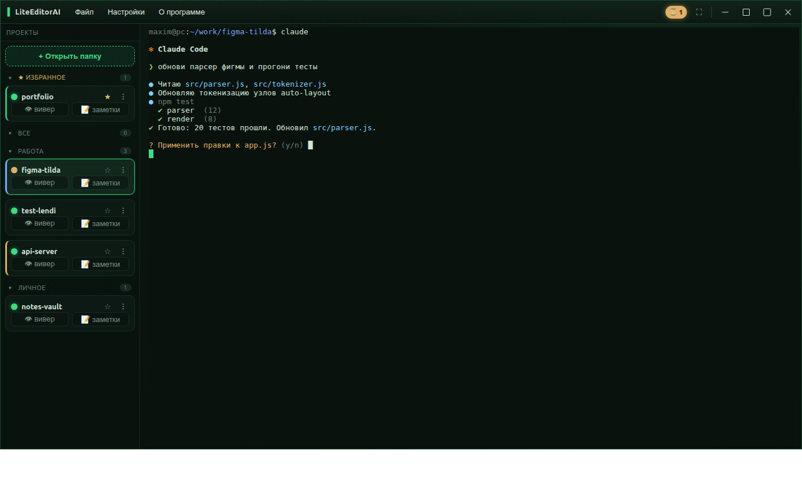
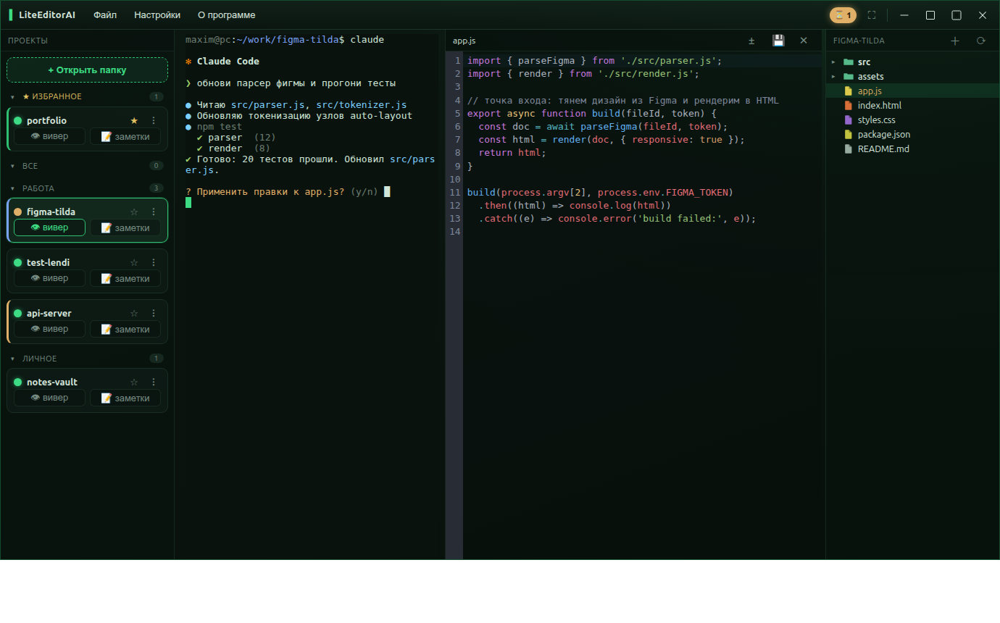
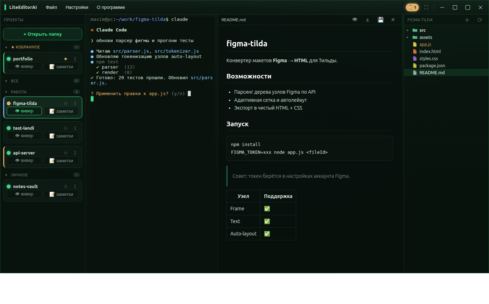
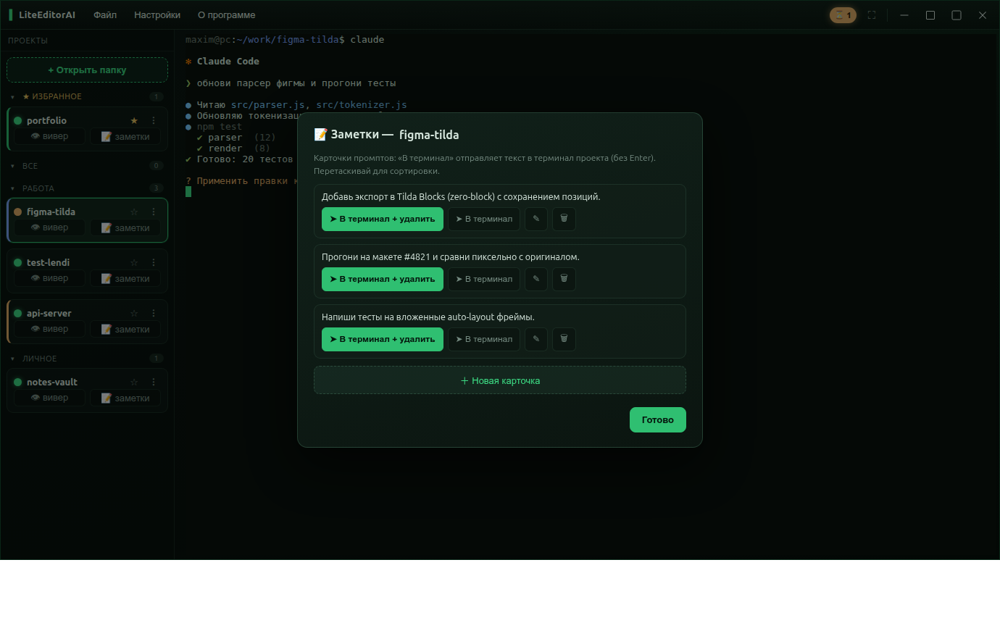

<div align="center">

# ▍ LiteEditorAI

**Лёгкий редактор для работы с ИИ-агентами прямо в терминале.**

[](LICENSE)
[](https://github.com/DanielLetto2020/LiteEditorAI/releases)
[](#установка)
[](https://www.electronjs.org/)
[](#статус)

У каждого проекта свой живой терминал, рядом — просмотр и правка файлов, дерево и git.
Открыл папку — сразу работаешь с агентом (Claude Code, Codex, Qwen, Kimi и др.).

</div>



## Зачем

Когда гоняешь несколько ИИ-агентов в терминалах, неудобно: где какой, кто закончил, кто ждёт ответа,
что агент наменял в файлах. LiteEditorAI собирает это в одно лёгкое окно:

- **Терминал на каждый проект.** Переключаешься между агентами как между вкладками.
- **Индикатор состояния агента:** работает (спиннер) · ждёт твоего ответа (янтарный) · готов (зелёный).
  Плюс системные уведомления и счётчик «сколько агентов ждут».
- **Живой просмотр кода:** дерево файлов, подсветка, правка с сохранением, дифф изменений,
  превью Markdown / картинок / HTML. Дерево само обновляется, пока агент правит файлы.
- **Заметки-промпты на проект:** копишь следующие промпты карточками и шлёшь их в терминал в один клик.
- **Git под рукой:** статус в дереве, ветки, коммит / пуш / пул, откат файла — без выхода из окна.
- **Без лишнего:** ничего не настраивать на старте, маленькая панель настроек, тёмные темы.

## Возможности

| | |
|---|---|
| 🖥 **Терминал на проект** | свой живой PTY у каждого проекта; перезапуск/очистка в один клик |
| 🚦 **Статус агента** | работает / ждёт ввода / готов + уведомления + счётчик в шапке и трее |
| 📁 **Проекты** | категории, избранное, акцент-цвет, скан-папки, рабочая папка |
| 👁 **Вивер** | CodeMirror, подсветка, правка (Ctrl+S), поиск в файле, дифф vs HEAD |
| 🔎 **Превью** | Markdown, картинки и HTML-страницы (с ресурсами из папки проекта) |
| 📝 **Заметки-промпты** | карточки, отправка в терминал, drag-сортировка, фикс раскладки EN↔РУ |
| ⎇ **Git** | статус в дереве, ветки, commit/push/pull/fetch, откат файла, `git init` |
| ⌨️ **Удобство** | палитра команд `Ctrl+K`, переключение проектов `Ctrl+1..9`, drag-and-drop папки |

## Скриншоты

| Терминал и проекты | Вивер + git + дерево |
|---|---|
|  |  |

| Превью Markdown | Заметки-промпты |
|---|---|
|  |  |

## Установка

Готовые сборки — на странице [**Releases**](https://github.com/DanielLetto2020/LiteEditorAI/releases).

### Ubuntu (x64)
```bash
sudo dpkg -i LiteEditorAI_*.deb
sudo apt -f install      # если попросит зависимости
```
Либо двойной клик по `.deb`. Запуск — иконка **LiteEditorAI** в меню приложений.

### Windows (x64)
Скачай установщик `.exe` (или portable) и запусти. Приложение пока без цифровой подписи —
Windows SmartScreen может предупредить: «Подробнее» → «Выполнить в любом случае».

## Сборка из исходников

```bash
npm install        # ставит зависимости + собирает node-pty под Electron
npm start          # сборка фронта + запуск
```

Требуется Node.js 18+ и Linux/Windows x64. Подробнее для разработчиков — в [CONTRIBUTING.md](CONTRIBUTING.md).

## Горячие клавиши

| Клавиши | Действие |
|---|---|
| `Ctrl+\` | режим «один терминал» |
| `Ctrl+K` | палитра команд |
| `Ctrl+F` | поиск (в терминале или в открытом файле) |
| `Ctrl+S` | сохранить файл |
| `Ctrl+1..9` / `Ctrl+Tab` | переключение проектов |
| `Ctrl + +/−` | размер шрифта |
| `F11` | полный экран |

## Статус

**Alpha.** Активно дорабатывается. Один терминал на проект; терминалы не переживают перезапуск.
Баги и идеи — в [Issues](https://github.com/DanielLetto2020/LiteEditorAI/issues).

## Лицензия

[Apache License 2.0](LICENSE) © 2026 Максим Кузьминский. При использовании и в производных работах
сохраняйте указание автора (см. [NOTICE](NOTICE)).

Сделано на [Electron](https://www.electronjs.org/), [xterm.js](https://xtermjs.org/),
[node-pty](https://github.com/microsoft/node-pty) и [CodeMirror 6](https://codemirror.net/).
